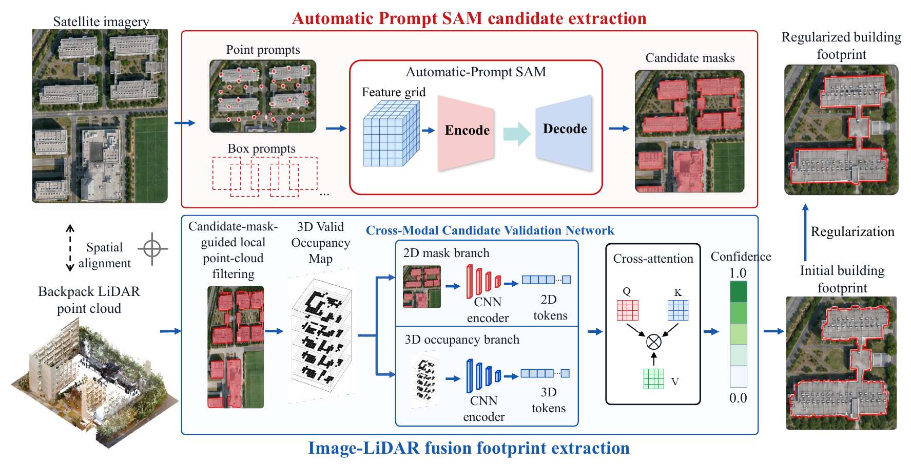

# Cross-Modal Building Footprint Extraction

本项目从卫星影像和背包式 LiDAR 点云提取建筑物轮廓。首先用自动点提示和多尺度框提示引导 SAM 生成候选，再用候选区域内的分层点云构建连续占据图。跨模态网络根据影像掩膜和 LiDAR 占据图验证候选，最后提取并规则化建筑边界。



*原论文 Figure 2，总体方法流程。*

## 1. 环境与安装

论文实验使用 Windows、RTX 3090、PyTorch 2.0.1 和 CUDA 11.8。当前仓库的固定安装配置面向 **Python 3.12、PyTorch 2.6.0、torchvision 0.21.0 和 CUDA 11.8**。两个环境的 PyTorch 版本不同。[PyTorch 官方历史版本安装说明](https://pytorch.org/get-started/previous-versions/#v260)

在仓库根目录，用 PowerShell 执行：

```powershell
py -3.12 -m venv .venv
.\.venv\Scripts\Activate.ps1
python -m pip install -r requirements.txt
python -m pip install torch==2.6.0 torchvision==0.21.0 --index-url https://download.pytorch.org/whl/cu118
python -m pip install .
python -m pip install "git+https://github.com/facebookresearch/segment-anything.git@6fdee8f2727f4506cfbbe553e23b895e27956588"
footprint --help
```

CPU 测试可将 PyTorch 安装命令中的 `cu118` 改为 `cpu`，并将下文的 `--device cuda` 改为 `--device cpu`。如果只处理已有候选标注，可以省略上游 SAM 的安装。

## 2. 数据准备

论文数据来自**河海大学江宁校区**和**南京一处村庄**。背包式 LiDAR 使用 NavVis VLX 采集，卫星影像来自 Google Earth，参考建筑轮廓由人工解译和矢量化获得。按论文的数据可用性声明，原始数据可在合理请求下向通讯作者申请。本仓库提供处理代码，运行前请将获授权的数据准备成下面的结构：

```text
data/
├── campus/
│   ├── image.tif             # 与点云对齐的 RGB GeoTIFF
│   ├── filtered.ply          # 已配准、去除明显地面点的点云
│   ├── candidates.json      # 像素坐标建筑候选，可由 SAM 生成
│   ├── splits.json          # 候选 ID 到建筑实例、集合、验证标签的映射
│   └── reference.gpkg       # 校园测试区人工参考轮廓
└── village/
    ├── image.tif
    ├── filtered.ply
    ├── candidates.json
    └── reference.gpkg
weights/
└── sam_vit_h_4b8939.pth
output/
└── campus-samples/
    ├── samples.json
    └── candidate_000000.npz
```

校园共 102 栋建筑，按建筑实例划分为 61 栋训练、10 栋验证和 31 栋测试。村庄 30 栋建筑仅用于独立外部测试。一个建筑实例对应的候选必须留在同一集合。验证候选需要独立的 0/1 真伪标签，最终测试用人工轮廓留到评价阶段。

```json
{
  "1": {"instance_id": "campus-building-01", "split": "train"},
  "2": {"instance_id": "campus-building-25", "split": "validation", "label": 1},
  "3": {"instance_id": "campus-background-A", "split": "validation", "label": 0},
  "4": {"instance_id": "campus-building-90", "split": "test"}
}
```

上面只展示分组格式。请给实际 manifest 中的所有候选提供对应记录，验证集需包含正负候选。

点云和 GeoTIFF 使用同一投影坐标系，坐标单位为米。原始点云尚未配准时，参照 [控制点模板](control-points.example.json) 将实际控制点保存为 `data/campus/controls.json`，再运行：

```powershell
footprint register --ply data/campus/raw.ply --controls data/campus/controls.json --output output/campus-aligned.ply
```

配准后先做地面点预处理，再保存为 `filtered.ply`。也可在样本构建时同时传入 `--ground-dem` 和 `--ground-clearance` 使用同坐标与高程基准的 DEM。若已有候选标注，可跳过 SAM。否则，从 [SAM 官方仓库](https://github.com/facebookresearch/segment-anything#model-checkpoints) 下载 [ViT-H 检查点](https://dl.fbaipublicfiles.com/segment_anything/sam_vit_h_4b8939.pth)，保存到 `weights/`。

```powershell
footprint sam-candidates --geotiff data/campus/image.tif --checkpoint weights/sam_vit_h_4b8939.pth --device cuda --dedup-iou 0.8 --min-area 10 --max-area 10000 --max-aspect 8 --min-compactness 0.15 --output data/campus/candidates.json
footprint prepare-samples --ply data/campus/filtered.ply --annotations data/campus/candidates.json --geotiff data/campus/image.tif --min-points 2 --output output/campus-samples
```

这些命令中的显式筛选阈值是接口示例，应以原实验记录为准。已报告的默认值在 [default.yaml](configs/default.yaml)。[village.yaml](configs/village.yaml) 继承统一设置，可通过 `footprint --config configs/village.yaml <子命令>` 显式加载。村庄数据单独运行候选生成和样本构建。

## 3. 训练

预训练的 **SAM ViT-H** 只用于候选生成。跨模态候选验证网络从头训练，权重由下面这一条命令生成：

```powershell
footprint train --manifest output/campus-samples/samples.json --assignments data/campus/splits.json --tau-positive 0.6 --tau-negative 0.2 --eta-positive 0.6 --eta-negative 0.2 --device cuda --output output/candidate-net.pt
```

伪标签数值是命令示例。复现实验时请使用原实验阈值。检查点保存验证集候选 F1 选出的置信度阈值，供测试复用。

## 4. 测试与推理

在 PowerShell 中一次粘贴以下代码块。它从已生成的校园样本与训练权重开始，依次运行推理、轮廓提取和评价，输出 JSON 并显示与论文 Table 1 **Ours** 行对应的四列指标。示例中的提取阈值与评价分辨率须按原实验记录设置。

```powershell
& {
    footprint predict --manifest output/campus-samples/samples.json --assignments data/campus/splits.json --checkpoint output/candidate-net.pt --device cuda --output output/campus-confidence.json
    if ($LASTEXITCODE -ne 0) { throw "Prediction failed" }
    footprint extract --manifest output/campus-samples/samples.json --confidence output/campus-confidence.json --occupancy-threshold 0.2 --component-overlap 0.25 --min-area 1 --closing 0.2 --max-hole 0.5 --snap-angle 8 --max-shift 0.3 --output output/campus-footprints.gpkg
    if ($LASTEXITCODE -ne 0) { throw "Extraction failed" }
    footprint evaluate --prediction output/campus-footprints.gpkg --reference data/campus/reference.gpkg --resolution 0.10 --id-field group_id --output output/campus-metrics.json
    if ($LASTEXITCODE -ne 0) { throw "Evaluation failed" }
    $m = Get-Content output/campus-metrics.json -Raw | ConvertFrom-Json
    [pscustomobject]@{Method='Ours'; 'Precision (%)'='{0:F2}' -f (100*$m.precision); 'Recall (%)'='{0:F2}' -f (100*$m.recall); 'F1 (%)'='{0:F2}' -f (100*$m.f1); 'IoU (%)'='{0:F2}' -f (100*$m.iou)} | Format-Table
}
```

评价前确保预测和参考轮廓使用一致的建筑实例 ID。若 ID 不同，先提供正确的对应关系。轮廓输出需要一个新 GeoPackage 路径。测试村庄时，用独立村庄样本、参考轮廓和输出路径，推理命令省略 `--assignments`，沿用校园检查点及固定阈值。

## 5. 论文结果

**论文 Table 1，河海大学江宁校区测试集。** 下表是论文中报告的数值。

| 方法 | 输入 | Precision (%) | Recall (%) | F1 (%) | IoU (%) |
|---|---|---:|---:|---:|---:|
| SAMPolyBuild (2024) | 卫星影像 | 93.62 | 90.13 | 91.84 | 84.91 |
| Pix2Poly (2025) | 卫星影像 | 93.24 | 92.36 | 92.80 | 86.58 |
| AlphaShape (2024) | 无人机 LiDAR | 93.71 | 93.28 | 93.49 | 87.78 |
| DLS-Footprint (2025) | 背包式 LiDAR | 94.17 | 94.62 | 94.39 | 89.37 |
| Dual P-Snake (2024) | 卫星影像 + 无人机 LiDAR | 94.47 | 93.87 | 94.17 | 88.98 |
| **Ours** | **卫星影像 + 背包式 LiDAR** | **95.41** | **95.57** | **95.49** | **91.37** |

本仓库的 `train → predict → extract → evaluate` 对应 **Ours**。其余五行需要相应方法的原始预测轮廓，取得后可在相同研究区、参考轮廓、匹配和栅格分辨率下用同一评价入口计算。复现表中具体数值依赖原始数据、模型与实验设置。评价额外输出 mIoU 和匹配建筑的 PoLiS，二者未列入论文 Table 1。

## 6. 引用与许可证

```bibtex
@unpublished{li_satellite_image_guided_footprints,
  author = {Li, Jia and Huang, Sijing and Lan, Qiuping and Huang, Yijie and Shi, Xiaoxuan and Li, Zikuan},
  title  = {Satellite-Image-Guided Building Footprint Extraction from Backpack {LiDAR} Point Clouds},
  note   = {Manuscript}
}
```

代码采用 [MIT License](LICENSE)。数据使用条件按数据提供方的授权执行。
